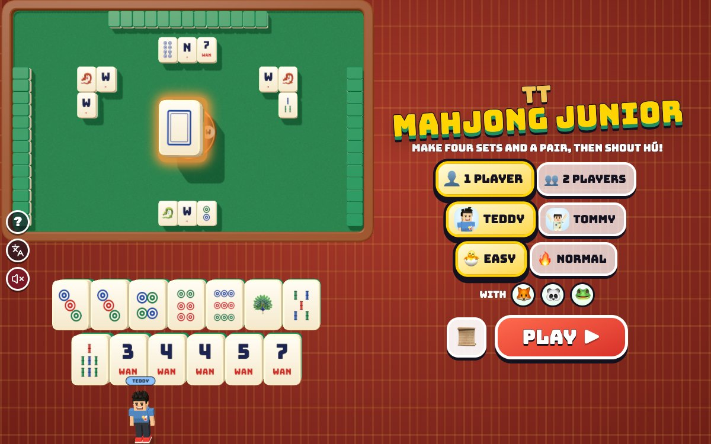

# TT Mahjong Junior

[](https://adong.github.io/mahjong-junior-tt/)

Press **?** any time (or tap the round **?** button on the left edge) to see the keys. The game waits while you look.
Tap the language button under it (the A文 icon) to switch between English and 中文; the dashboard and every game remember the choice.

A simplified family mahjong for Teddy and Tommy, on a green felt table with real-looking ivory-and-jade tiles: learn the tiles (dots, bamboo, characters, winds and dragons), make sets (a CHOW is three in a row, a PUNG is three the same) and a pair, and shout **HÚ!** to win, against 🦊 Foxy, 🐼 Panda and 🐸 Froggy, or both brothers at one table. No money, no betting: just points and smiles.

**中文：** 小麻将！认识麻将牌（筒子、条子、万子、风和红中发财白板），凑"吃"（同花色连着三张）和"碰"（三张一样的），再加一个对子，就喊"胡"！和 Foxy 🦊、Panda 🐼、Froggy 🐸 一起玩，或者兄弟俩一起上桌。不玩钱，只玩分数和笑脸。

Part of the 中国 series (Alan: so the boys feel their culture), built with Claude Code from plain JavaScript and Three.js on the shared Claude Games kit. There are no image, model or audio files: the boys are the kit's blocky characters, every tile face is painted on a canvas, and every sound is synthesised.

The name is a working title. It lives in one constant, `MJ_TITLE` in `js/title.js`, and the page title, the logo and the ? panel read it from there.

## Play

- **Double-click `index.html`.** It works offline because Three.js and the kit are copied into `kit/`. Without internet the title font falls back to Arial Black.
- **Send one file:** `dist/mahjong-junior-tt.html` is the whole game in one page. AirDrop or email it, then open it in a browser.
- Rebuild that file after any edit: `python3 kit/tools/bundle.py . --name mahjong-junior-tt`

### A round

- **Who plays:** **1 PLAYER** is you (Teddy or Tommy, at the bottom) with 🦊 Foxy on your right, 🐼 Panda across and 🐸 Froggy on your left. **2 PLAYERS** puts Teddy at the bottom and Tommy across the table (his tiles face up at the top), with Foxy and Froggy. Everything is remembered.
- **Level:** **🐣 EASY** is the default, for Tommy (5); **🔥 NORMAL** is for Teddy (8). See *Levels* below.
- **The deal:** everyone gets 13 tiles. The wind disc in the middle shows each seat's wind (the dealer is **East**, in red), whose turn it is (the gold bubble) and how many tiles are left in the wall. The first round starts with you; after that the deal goes round the table.
- **Your turn:** a tile slides out of the wall into your hand (a little apart from the rest). **Tap a tile** and it pops up (on 🐣 EASY it says its name: "3 DOTS"); **tap it again** to throw it away. It waits big on the wind disc while everyone decides whether to take it, then goes into your pile in front of you.
- **Taking a thrown tile:** when someone throws a tile you can use, yellow buttons pop up with the tiles in them: **PUNG** (three the same, anyone can), **CHOW** (three in a row, only the next player, so only from the friend on your left), **HÚ!** (it wins), or **PASS**. Taking it shows the set face up beside your hand, and then you throw a tile (no draw).
- **HÚ!** When your 14 tiles are four sets and a pair, a big red **HÚ!** button pops up. Tap it: the winner does his signature move (Teddy's boxing combo or 🏀 jump shot, Tommy's Y with ✌️), confetti falls, the winning hand is shown with its sets apart and the winning tile ringed, and the points are added up. **PLAY AGAIN** deals the next round; the scoreboard keeps running until you go home.
- **A friend wins:** their badge spins and you shrug. **The wall runs out:** it's a draw and nobody scores.
- **📜** opens a 4-page story card (also by itself the first time you play): where mahjong comes from, the tiles, the turn, and HÚ.

### The tiles (136, four of each)

| Tiles | English | 中文 |
|---|---|---|
| Dots 1 to 9 (coins) | painted coins, the 1 a big flower coin | the same |
| Bamboo 1 to 9 (strings of coins) | bamboo sticks, the 1 a peacock 🦚 | the same |
| Characters 1 to 9 (万, ten thousand) | a big number and **WAN** in red | 一 to 九 over a red 万 |
| Winds | **E S W N** with a little compass needle | 东 南 西 北 |
| Dragons | a red 🐉, a green 🐉, a blue frame | 中 (red), 发 (green), the blue frame (白板) |

On 🐣 EASY each suit tile has its number in the corner. English mode has no Chinese characters anywhere, tiles included; 中文 mode paints the real characters, in a brush-style (楷体) font where the device has one.

### The rules (a family simplification)

- Four seats, play goes round the table: you → right → across → left. Draw a tile, throw one.
- A thrown tile can be taken: **HÚ** by anyone (the nearest in turn order if two can), then **PUNG** by anyone, then **CHOW** by the next player only. A chow is three in a row of one suit: no 8-9-1, no winds or dragons.
- **Win:** four sets (pungs or chows) and a pair, 14 tiles with the shown sets, by drawing it yourself or taking a throw.
- **Left out** to keep it simple: kongs (four the same), flowers, minimum points and paying. A fourth tile of a kind is just a tile.
- **Points:** WIN 10, SELF-DRAWN +5 (自摸), NO CLAIMS +5 (门前清), ALL CHOWS +5 (平胡), ALL PUNGS +10 (碰碰胡), ONE SUIT + HONOURS +10 (混一色), ALL ONE SUIT +20 (清一色), ALL HONOURS +30 (字一色), and +5 for each DRAGON PUNG. Only the winner scores; nobody loses points.

### Levels

- **🐣 EASY (Tommy):** the friends slip (3 throws in 10 are so-so ones) and rarely take tiles. Your hand is sorted into **sets, then pairs, then loose tiles**, with a green line under each set and a blue one under each pair, so the loose ones (the ones to throw) are easy to spot. "ONE TILE TO WIN!" says when you're ready. And a kid gets a lucky draw now and then: 4 times in 10, a tile that brings his hand nearer a win comes up from deeper in the wall (the same tiles, in a different order).
- **🔥 NORMAL (Teddy):** the friends play properly: the throw that keeps them nearest a win with the most tiles that help, and they take every tile that helps. Teddy gets a lucky draw only 1 time in 10, and no sorting help.
- With bots standing in for the boys (400 rounds each): on EASY a careless bot (4 throws in 10 so-so, like a 5-year-old) won 64% of rounds (7% draws) and a good one 92%; on NORMAL a good bot won 41% and a careless one 15% (a fair four-way table is 25%).

## Controls

| | Keys | Touch |
|---|---|---|
| pick a tile to throw | ← → | tap it |
| throw it | Enter or Space | tap it again |
| take the tile on offer (chow, pung) or win (hú) | 1 2 3 (as numbered on the buttons) | the yellow / red buttons |
| win (hú) when you can | H | HÚ! |
| no thanks (pass) | X | PASS |
| call your brother (2 players: high five) | T | his face, bottom right (🙌 in 2 players) |
| pause · sound | P or Esc · M | ⏸️ · 🔊 |
| menu: play · the story | Enter · B | the buttons |
| menu: 1 player · 2 players · Teddy or Tommy · level | 1 · 2 · W · L | the buttons |

- **Sound:** 🔊 at the top right while playing; on the menus, the pause screen and the result the kit's round speaker button sits under the A文 button, and the ? panel has one too. One switch for every game (`claudeGames.muted`).
- **Layouts:** on a wide screen the boys stand in a strip on the left and your hand stands on the table's edge; on a phone held upright the hand is two rows under the table and the boys are at the bottom. The kit's ? and A文 buttons sit over the boys' strip, never over the table or the hand.

## Call your brother (companion mode)

**In 1 player** the other brother is free to help. Call him with **T** or by tapping his face (bottom right), **any time and as often as you like** (`Kit.roster.buddyFor`: Tommy for Teddy, Teddy for Tommy).

- **He pops in** beside you in a puff of stars, at his roster `buddyScale`, with his name tag.
- **He says hi** with his signature move (Tommy's Y with ✌️, Teddy's boxing combo or jump shot) and **tosses you a treat** (🍦 💧 🧃 🍪 🍉 🍌): "🧃 JUICE BOX FROM TOMMY!"
- **Then the best throw glows.** He turns and points, the best tile to throw away glows gold, and he says which: "TOMMY SAYS: THROW THE WEST WIND!" It's 🔥 NORMAL's choice without any slips (nearest a win, most tiles that help). If you can win he says "SAY HÚ! YOU WIN!" and the HÚ button glows; if a tile is on offer he says "TAKE IT! PUNG!", "TAKE IT! CHOW!" or "PASS THIS ONE!" and that button glows. If it isn't your turn yet he waits for it.
- He cheers when you throw his tile or take a set, then does his goodbye move and pops out. Call him again while he's there and he says hi again, brings another treat and helps again.

**In 2 players** both brothers are at the table, so **T** (or 🙌) is a **high five**: they run together, slap hands (💥) and run back. It doesn't change the game.

## Make it yours

- `js/title.js`: the game's name.
- `js/rules.js`: `LEVELS` (how often the friends slip and take tiles) and `score()` (the points).
- `js/game.js`, top: `LUCK` (how often a kid's draw is a lucky one), `THINK` and `SHOW` (how fast the friends play), `FRIENDS` (their emoji).
- `js/stage.js`: the tile faces (`faceCanvas`: the dot and bamboo patterns are tables near the top), the table and the wind disc.
- `js/layout.js`: where everything goes on wide and tall screens.

## How it works, and how it's tested

- `js/rules.js` has no Three.js and no page in it: the tiles, a round (deal, draw, throw, claims and who goes first, win), points, and the CPU friends' brains. The same file runs the game and the headless check.
  - **Win detection:** a pair, then pungs and chows from the lowest tile up.
  - **How far from a win** (shanten): every suit split on its own into sets, part-sets and a pair (kept per suit pattern, so it's quick), then combined. The friends throw the tile that leaves them nearest a win with the most unseen tiles that help; they take a tile when it brings them nearer.
- `js/layout.js` works out every tile's spot in screen pixels; `js/stage.js` glides the 136 tile objects there (and turns them over); `js/game.js` runs the turns, the claim buttons, the friends' timing and the screens.
- Console hooks (`window.game`):

```js
game.start({ mode: 'solo', who: 'tommy', level: 'easy', seed: 7 })  // or mode: 'two'
game.step(2)             // advance 2 s and draw (when the browser tab's animation is throttled)
game.hold(true)          // freeze the live loop, so only game.step() moves time
game.tap(id)             // tap a tile in the hand (first tap picks it up, the second throws it)
game.throwBest()         // throw the best tile
game.choose({ type: 'pung' })   // answer the claim buttons ({ type: 'chow', ix }, { type: 'win' }, or null to pass)
game.autoKid()           // the kid being waited on plays like the best bot
game.autoRound()         // play the round to the end that way
game.call()              // call your brother (2 players: high five)
game.check()             // the headless check below (60 CPU games), and game.checkCanFail()
game.info()              // state, turn, wall, hands, waits, claim buttons, the brother, layout rectangles
```

The same check runs from a terminal with Node:

```bash
node tools/check.js
```

```bash
node tools/check.js --can-fail
```

- **Win detection on test hands** (59 checks): four sets and a pair; four pungs; nine-gates hands; all honours; three and four sets already shown; and the ones that must not win: seven pairs, four sets and no pair, 8-9-1, east-south-west, the dragons in a row, 9 dots with 1-2 bamboo, 13 and 15 tiles, a too-short hand. Each is checked three ways: the game's win finder, a second one written separately (sets taken from the top kind down) and "how far from a win" = -1. Plus the waits of three ready hands.
- **Made-up hands** (8,393 checks): 3,000 random winning hands, each with one tile swapped, and 3,000 random hands (with and without a shown set): the two win finders and the shanten count always agree.
- **Chow and pung rules** (32 checks): chows every way round (3 with 1-2, 2-4, 4-5; 5 bamboo three ways); no wrapping, no mixing suits, no winds or dragons; only the next player can chow; one tile isn't a pung; two across can pung; the thrower can't claim; a pung beats a chow, a win beats a pung, two wins go to the nearer seat; a pung shows three of the same tile, the hand gives two, the throw leaves the pond, the taker throws next without drawing; a chow shows 1-2-3; nobody taking it passes the turn; an empty wall ends the round in a draw.
- **CPU games end:** 240 rounds with every mix of 🐣 EASY, 🔥 NORMAL and the best bot (with and without lucky draws), plus 30 rounds with only 8 tiles left in the wall (mostly draws). Every step: every tile is somewhere exactly once, every hand has the right number of tiles, every shown set is real. Every round must end within the step limit, every win must be four sets and a pair by the second finder, and a draw must have an empty wall. At the last run: 270 of 270 ended (240 wins, 30 draws), in about 3 seconds.
- **It can fail:** `--sabotage` plants one bug and the check must fail. `sevenPairs` (seven pairs win), `noPair` (any two tiles do for the pair), `wrapChow` (8-9-1), `honourChow` (winds in a row), `anyChow` (anyone can chow), `chowFirst` (a chow beats a pung), `lostTile` (a taken tile vanishes) and `endless` (an empty wall doesn't end the round) were all caught.
- **The browser:** whole rounds through the real renderer (1 and 2 players, EASY and NORMAL, many rounds in a row with the dealer moving round), the result panel, the brother's visit (treat, "THROW THE WEST WIND!" with the right tile glowing), the high five, real pointer taps (pick then throw a tile, the PUNG button) and real keys (← ← Enter). The first PLAY opens the story card and holds the round until it's closed. 中文: home, the story, the ? panel, play, a picked tile, the brother, a claim ("要 FOXY 打的九筒吗？"), pause, the result, 2 players: `Kit.lang.untranslated()` stayed `[]`, and a planted page string was caught. English: no Chinese characters anywhere except the kit's language button tooltip. Layouts checked by headless screenshot: 1200×750, 1024×768, iPad 768×1024, phone upright 390×844 and on its side 740×360. `index.html` and `dist/mahjong-junior-tt.html` both boot and play a round to the result from `file://` in headless Chrome, with the in-page check passing. No console errors.

## Files

```
index.html                  page, HUD, seat badges, claim buttons, menus, panels (CSS inline)
js/title.js                 the game's name (one constant)
js/rules.js                 the tiles, a round, claims, win detection, shanten, points, the CPU friends (no Three.js)
js/check.js                 the headless check (game.check, tools/check.js)
js/stage.js                 the table, the wind disc, the 136 tiles and their painted faces, glows, the set lines
js/layout.js                where every tile, badge, boy and button goes on wide and tall screens
js/actor.js                 a boy beside the table (from TT Memory Match, by way of TT Tile Link)
js/buddy.js                 your brother's visit and his best throw, and the high five
js/fx.js                    emoji flyers, confetti
js/sfx.js                   game sounds on top of Kit.sound
js/game.js                  the menu, turns, claims, the result, the story, input, main loop, window.game hooks
js/keys.js                  the keys the ? panel shows (Kit.help)
js/zh.js                    中文 for every word the player sees (Kit.lang), every tile's name; names stay English
tools/check.js              runs the headless check under Node
tools/shoot.js              screenshots with headless Chrome (docs/screenshot.jpg: node tools/shoot.js tools/shots.json docs 1200 750)
kit/                        copy of ~/claude-games/kit (python3 ../kit/tools/sync.py .), never edited here
dist/mahjong-junior-tt.html the single-page build
```

## Not verified

- **Sound:** the synth code runs without errors, but nobody listened to it (all testing was muted).
- **Real touch devices:** taps were checked with a mouse in the browser and in phone and tablet sizes, not on a real phone or iPad. On a phone on its side the hand tiles are about 35 px wide.
- **Real kids:** the levels were tuned with bots. Whether 🐣 EASY's helps are enough for Tommy (5) and whether 🔥 NORMAL is fair for Teddy (8) needs Tommy and Teddy. A round should take about 2 to 3 minutes; that was worked out from the friends' timing, not timed with a kid.
- **Speed on an older iPad:** 136 tiles with shadows; nothing was timed on a real iPad.
- **Double-click from Finder:** both pages were opened from `file://` in headless Chrome, not by double-clicking in Finder.
- **The iPad home-screen icon:** 🎴 on gold (#f1c453), drawn by script like the siblings'; nobody added it to a real iPad.
